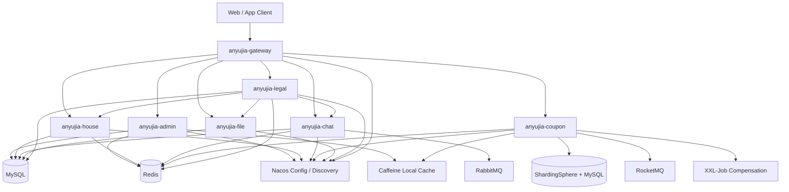

# Anyujia

Anyujia 是一个基于 Spring Cloud Alibaba 的租房平台后端项目，采用 Maven 多模块结构，覆盖用户与后台管理、房源发布、即时聊天、平台优惠券、文件存储和租房法律风险评估等业务能力。

项目已完成源码脱敏处理，运行密码、Token、AK/SK 等敏感配置均应通过环境变量或私有配置中心注入，不应提交到 Git。

## 技术栈

- Java 17, Spring Boot, Spring Cloud Alibaba, Nacos
- MyBatis-Plus, MySQL, ShardingSphere
- Redis, Redisson, Caffeine
- RocketMQ, RabbitMQ
- Netty WebSocket, Spring WebSocket
- Docker Compose, Maven
- EasyExcel, XXL-Job 相关批量任务与补偿任务设计

## 模块结构

| 模块 | 说明 |
| --- | --- |
| `anyujia-gateway` | API 网关、鉴权过滤、WebSocket 票据校验和请求转发 |
| `anyujia-common` | 公共返回体、异常处理、Redis、缓存、线程池、安全工具等公共能力 |
| `anyujia-admin` | 后台管理、用户管理、字典参数、行政区划与地图服务 |
| `anyujia-house` | 房源发布、审核、公开查询和租赁商品信息 |
| `anyujia-chat` | 租客与房东即时聊天、消息持久化、离线同步、Netty WebSocket |
| `anyujia-coupon` | 平台优惠券、区域补贴券、高并发申领、批量发券、用户券结算与状态流转 |
| `anyujia-file` | 文件上传、私有对象存储、上传签名和文件访问 |
| `anyujia-legal` | 租房合同风险识别、法律知识检索、证据追踪和评估报告 |
| `anyujia-mstemplate` | 微服务模板与基础连通性示例 |
| `deploy` | Docker Compose、MySQL 脚本、RocketMQ、性能压测和评估脚本 |

## 系统架构



## 核心链路

### 区域补贴与优惠券

- 区域补贴查询使用 Caffeine + Redis 两级缓存，启动时预热行政区划和补贴配置热点数据。
- 热点 Key 失效时通过 Redisson 分布式锁和 Double Check 控制回源，降低缓存击穿风险。
- 高并发申领使用 Redis Lua 原子校验活动状态、用户资格、区域范围、领取次数和库存，并完成库存预扣。
- 申领成功后通过 RocketMQ 异步创建用户券，配合数据库条件更新、唯一索引和消费幂等，降低超发、重复领取和重复写入风险。
- 批量发券使用 EasyExcel 流式解析名单，Redis 暂存待发用户，分批投递 RocketMQ，由消费者批量落库。
- 用户券查询保留 Redis ZSet 用户券索引，用户券详情和模板详情走 Redis 缓存，available 查询使用 Pipeline 批量读取，数据库只作为 cache miss 兜底。
- 用户券按用户维度通过 ShardingSphere 分库分表，锁券、核销、退款和过期使用数据库条件更新控制并发修改。
- 过期处理使用 RocketMQ 延迟消息；失败任务通过任务状态、幂等记录和 XXL-Job 补偿扫描提高可靠性。

### 即时聊天

- 聊天服务支持 Spring WebSocket 和可选 Netty WebSocket。
- Netty 连接使用独立 EventLoop、写缓冲水位线、单连接队列上限和空闲连接回收，避免慢连接拖垮业务线程。
- 消息落库后通过 RabbitMQ 推送，客户端断线后可通过消息同步接口补齐未读消息。

### 租房法律风险评估

- 法务模块面向租客侧合同风险识别，支持 PDF/DOCX 文档解析、合同证据块持久化和风险报告生成。
- 评估上下文由合同条款、最近聊天记录、房源发布信息和法律知识片段组成，并写入上下文快照与追踪事件。
- 法律知识检索包含词法召回、法律意图召回、可选向量召回、RRF 融合和确定性重排。
- AI 增强默认关闭，缺少模型凭证或模型调用失败时仍保留确定性规则分析和引用兜底。

## 本地构建

```bash
mvn clean package -DskipTests
```

运行单个模块测试示例：

```bash
mvn -pl anyujia-coupon/anyujia-coupon-service test
```

## 开发部署

中间件和服务编排位于 `deploy/dev/app`：

```bash
cd deploy/dev/app
docker compose -p frameworkjava -f docker-compose-mid.yml up -d
```

首次部署前请复制 `.env.example` 为 `.env`，并替换其中所有 `change-me` 值。生产环境建议使用 Nacos、容器密钥或 CI/CD Secret 注入，不要把真实密码写入仓库。

常用服务端口：

| 服务 | 端口 |
| --- | ---: |
| Gateway | `18080` |
| Admin | `18081` |
| Chat HTTP | `18083` |
| Chat Netty WebSocket | `18084` |
| Coupon | `18085` |
| Nacos | `8848` |
| MySQL | `3306` |
| Redis | `6379` |
| RocketMQ NameServer | `9876` |

## 配置安全

仓库已忽略以下本地产物：

- `.env`, `.agent/`, `.idea/`
- `target/`, `node_modules/`, `dist/`
- `*.jar`, `*.war`, `*.log`, JVM dump/heap/profile 文件

提交前建议执行：

```bash
git grep -n -I -E "password|secret|token|accessKey|api-key"
```

确认没有真实凭证进入暂存区。

## 目录说明

```text
anyujia-frameworkjava
├── anyujia-admin
├── anyujia-chat
├── anyujia-common
├── anyujia-coupon
├── anyujia-file
├── anyujia-gateway
├── anyujia-house
├── anyujia-legal
├── anyujia-mstemplate
├── deploy
├── pom.xml
└── README.md
```
