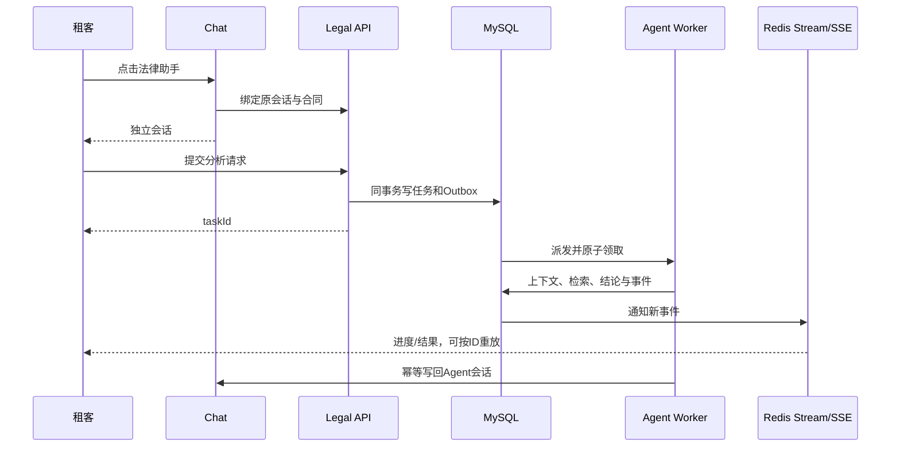

# 01 架构与项目表达

## Q01：用一分钟介绍法律 Agent。

**参考回答：** 租客在与房东沟通到签约时，点击法律助手会进入独立会话。服务绑定原聊天和合同，提取合同条款、聊天承诺、房源信息与有效法规，用混合 RAG 组装证据，再生成风险提示并逐条检查引用支持度。分析由持久化任务异步执行，进度通过 SSE 推送；输入变化时阻断旧答案，证据不足时降级或进入人工审核。

**追问准备：** 选一条自己真正能演示的链路，讲清“输入—执行—结果—失败恢复”，不要只背六个中间件名字。

## Q02：从点击到收到结果的实际路径是什么？

**参考回答：** Chat 创建独立 Agent 会话并请求 Legal 绑定；租客提交任务后，Legal 在 MySQL 同事务写任务与待投递 Outbox。异步 worker 领取任务、组装上下文、检索法规、生成并复核结论，结果进入任务与事件表，Redis Stream 唤醒 SSE，客户端也能用事件 ID 断线重放。回答再以幂等方式投递到独立会话。

**边界：** 图只表示逻辑阶段，不承诺完成任务与写结果事件属于同一个数据库事务；相应失败窗口另有补偿逻辑。

## Q03：为什么称为 Agent，不是普通 RAG API？

**参考回答：** 它会按固定工作流调用 Chat、House、File、法规检索与模型服务，维护任务、上下文版本、阶段状态、证据门禁和审核分支。RAG 是其中的证据检索阶段。编排由 Spring/Java 自研，没有使用 LangChain 或 Spring AI；它也是面向租赁风险的受控 Agent，不是开放式自主规划系统。

## Q04：为什么单独创建会话？

**参考回答：** 房东与租客的原聊天既是双方交流记录，也是法律分析证据。助手回答应由租客私有查看和追问，写入原聊天会混淆发言主体。独立会话绑定租客、原会话和合同，结果有清晰的权限及审计边界。

## Q05：四类输入各自提供什么？

| 来源 | 作用 | 可追溯定位 |
| --- | --- | --- |
| 合同 | 约定的权利、费用与责任 | 文档、条款块、段落 |
| 聊天 | 房东和租客的承诺、协商变化 | 原会话消息 ID |
| 房源 | 租金、押金、设施等发布事实 | 房源/商品快照 |
| 法规 | 规范依据与适用条件 | 法规版本、条文、来源 |

**追问：** 聊天承诺与合同矛盾时，先报告事实冲突和来源，不能由模型凭空裁决哪一方当然有效。

## Q06：什么是这套系统最重要的不变量？

**参考回答：** 非本租客不能读取该合同、任务和事件；同一 requestId 重试应得到同一逻辑任务；旧 worker 不能覆盖新租约持有者的终态；上下文变化时旧答案不能发布；生成的引用必须来自当次允许的证据集；完成结果写回 Chat 要幂等。测试不能只看 HTTP 200。

## Q07：这个系统有没有过度设计？

**参考回答：** 对早期租赁业务，最小版本可以先做合同解析、明确规则、单库异步任务和可引用答案。多实例租约、Outbox、Redis Stream 和 NLI 主要解决高并发、故障恢复与证据审查的工程目标。独立开发项目也有验证架构的目的；生产采用前应根据请求量、审核成本和维护能力逐项取舍。

## Q08：你遇到最难的工程问题是什么？

**参考回答：** 我会讲“任务成功但通知或会话投递失败”的跨组件窗口：MySQL 任务是事实，事件和聊天消息是派生效果，不能靠一个 Java 方法当成原子操作。为此引入状态条件、Outbox、事件补偿和 Chat 幂等；测试时分别查任务终态、事件与会话消息。最后说明还有哪些故障窗口未完全覆盖。
