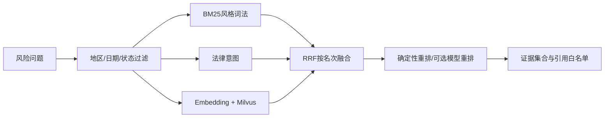

# 02 文档解析与混合 RAG

## Q09：Apache Tika 在合同链路负责什么？

**参考回答：** `TikaLegalDocumentExtractor` 用 `AutoDetectParser` 将 PDF/DOCX 统一提取为文本和元数据；后续 PDF/DOCX 解析器做条款块、段落及标题定位。Tika 本身不判断法律风险，也不保证所有文档都能精确还原排版。

## Q10：PDF/DOCX 页码都可靠吗？

**参考回答：** PDF 页通常有稳定边界；DOCX 页码会随字体、纸张和渲染器变化。项目保留块序号、段落、标题与原文映射作为主要定位，DOCX 页码只能辅助引用。扫描版 PDF 若没有文本层，还需 OCR，不能说 Tika 自动解决了所有扫描件。

## Q11：怎么处理恶意或损坏的合同？

**参考回答：** 上传与解析阶段应限制类型、大小、内容长度和执行时间，解析失败要返回可理解状态，不能把异常文本送进检索或模型。当前代码能捕获 Tika 解析异常；更完整的生产方案还要隔离高风险解析任务、扫描宏/附件与做 OCR 质量检查。

## Q12：为什么按条款切块，不直接每 500 字切一次？

**参考回答：** 租金、赔偿和例外条件可能跨相邻句子。固定截断容易丢掉责任主体或限定条件。按条款/段落保留标题、编号和原文位置，长条款再受控截断，并在引用时回到原块验证。

## Q13：法规版本与失效过滤怎么做？

**参考回答：** 先用地区、状态、生效和失效时间筛选，再处理同名法规的重叠版本。答案引用需包含具体版本与条文。过滤逻辑依赖法规库及时维护，不能保证外部法律变化实时同步。

## Q14：混合检索为什么有三路？

**参考回答：** 词法通道找精确措辞、编号和数字；意图通道覆盖“押金不退/保证金扣除”等领域表达；向量通道覆盖同义改写。三者互补，向量服务不可用时前两路仍可工作。

## Q15：这里是标准 BM25 还是 Elasticsearch？

**参考回答：** 当前是 Java 的 BM25 风格词法打分，实现位于 `HybridLegalRanker`。没有接入 Elasticsearch。面试时说明 BM25 主要考虑词频、文档频率和长度归一化；具体参数及分词方式以源码为准，不把“BM25 风格”说成完整搜索引擎能力。

## Q16：RRF 为什么能融合词法与向量结果？

**参考回答：** 两路原始分数尺度不同，RRF 使用排名贡献，例如 `weight/(k+rank)`，合并相同候选的贡献。它降低了分数标定要求，但候选筛选、法规有效性和最终引用审查仍须单独完成。

## Q17：Milvus、MySQL 分别存什么？

**参考回答：** MySQL 保存法规来源、正文、版本、状态和证据审计；Milvus 提供法规块向量的相似召回。向量结果映射回法规块后再进入重排。Milvus 开关默认可关闭，服务异常时按配置回退本地余弦或词法/意图通道。

## Q18：Embedding 和 Reranker 的区别？

**参考回答：** Embedding 把查询和片段编码为向量，适合从较多片段中召回；Reranker 对少量候选和查询逐对计算相关性，改善前几条顺序。二者是“相关性”工具，都不能直接判定法条是否支持生成结论。

## Q19：为什么要 citation allow-list？

**参考回答：** 生成文本可能输出看似真实的条款编号。系统只接受本次检索且授权的证据索引，引用必须映射到具体来源。它能防止不存在的引用进入结果，但无法单独发现“引用真实、解释错误”的情况，所以再接逐条支持度评估。

## Q20：法规没有召回时怎么办？

**参考回答：** 不应硬编一个结论。可以返回 `NO_EVIDENCE` 或说明证据不足，保留合同与事实层面的风险提示，并引导补充材料或人工复核。报告中的真实任务曾因法规库证据不足返回 `NO_EVIDENCE`，这是安全降级，不是完整问答质量通过。

## Q21：Recall@4 与 HitRate@4 有什么差异？

**参考回答：** Recall@4 衡量标注相关证据有多少出现在前四条；HitRate@4 衡量每个问题的前四条是否至少命中一条。34 条冻结检索样本的结果为 98.53% 和 100%，不能推成真实合同风险判断准确率。

## Q22：citation validity 100% 是否代表没有幻觉？

**参考回答：** 不代表。37 条回答样本中 validity 指引用是否来自允许集合，coverage 93.24% 指应引用事实的覆盖程度。引用真实仍可能曲解适用条件，还需 NLI、人工标注和高风险审核。
