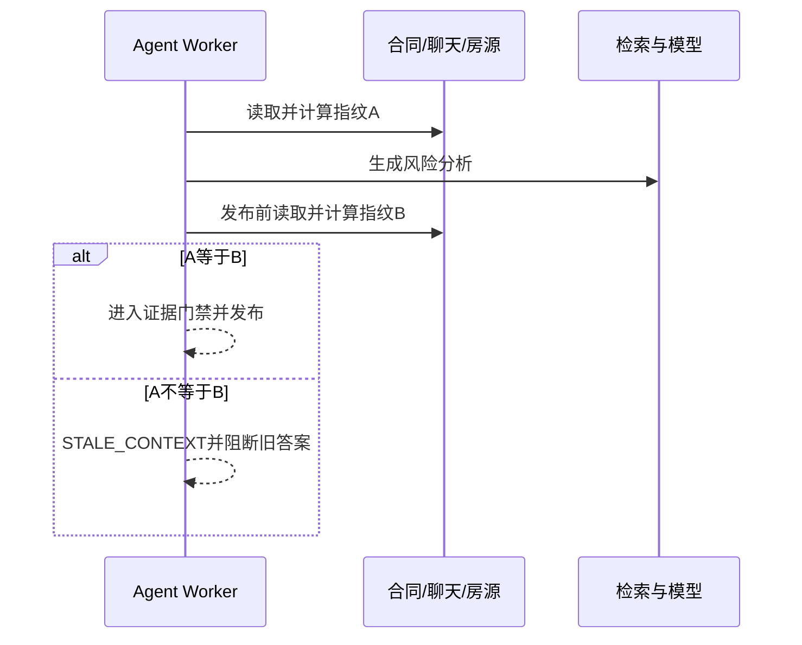

# 03 上下文、记忆与一致性

## Q23：为什么不能把整份合同和全部聊天直接发给模型？

**参考回答：** 长输入会增加推理成本和延迟，还可能截断关键条款。合同优先保留押金、维修、违约、解约、转租与退租内容；聊天提取金额、日期、责任主体和承诺，保留消息 ID。压缩内容用于分析，原文仍供核验。

## Q24：压缩摘要丢掉限定词怎么办？

**参考回答：** 这是实际风险。摘要必须连同原证据块 ID、消息 ID 和关键条件保存；结论引用时再检查原文，不能只引用摘要。应专门用“除非”“经同意”“正常损耗”等否定、例外和条件样本做回归。

## Q25：Redis 短期记忆与 MySQL MemorySnapshot 如何分工？

**参考回答：** Redis 缓存有界近期对话，降低重复读取；MySQL 保存可恢复摘要。评估本身还记录上下文快照和哈希，回答“这次分析依据了哪版合同和聊天”。不能把法规文本当作用户长期记忆，法规由受版本管理的知识库检索。

## Q26：Redis 故障就能无损恢复所有对话吗？

**参考回答：** 不能这么说。代码可尝试从 MySQL 快照恢复摘要或有限历史，原始合同与聊天需要从各自事实来源重新读取。缓存与快照的粒度不同，恢复后仍要核验当前上下文。

## Q27：SHA-256 指纹如何生成和使用？

**参考回答：** 对本次分析使用的合同块、聊天窗口、房源快照和相关检索上下文建立规范化输入，再计算哈希。开始时记录，发布前复查。指纹相同表示这些输入未观察到变化，不表示事实真实或法律解释正确。

## Q28：为什么生成后还要复查指纹？

**参考回答：** RAG 和模型调用可能耗时较长，期间房东新增承诺或租客上传新版合同。只在开始时校验会产生“刚生成就过期”的回答。复查不一致时标记 `STALE_CONTEXT`，停止发布并要求重新分析。

## Q29：什么情况会误判上下文变化？

**参考回答：** 若规范化方式不稳定，顺序、空白、时间格式或无关字段变化可能导致不同哈希。要固定字段、排序和编码，并区分真正影响结论的内容变化与展示性变更。压测不能代替这种语义回归。

## Q30：多轮追问会一直沿用首次法规检索结果吗？

**参考回答：** 不应无条件沿用。历史问答可帮助理解指代，但法规有效性与合同、聊天内容应按本轮日期及版本核验；上下文变化或命中条件变化就重新检索。长期摘要不能成为永久法律事实源。

## Q31：如何验证压缩没有明显降低质量？

**参考回答：** 构造同一问题的原文与压缩输入对照，检查风险条款召回、责任主体、金额、时间和引用 ID 是否保留；把否定与例外条款列为必测。现有 7 例上下文离线集是初步门禁，样本规模不足以证明生产可靠性。
