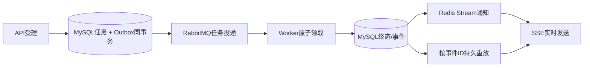

# 04 异步任务、Outbox 与 SSE

## Q32：为什么把分析做成异步任务？

**参考回答：** 合同解析、法规检索和模型推理延迟波动大。API 先持久化任务并返回 `taskId`，Worker 执行，前端收事件或查询状态。HTTP 受理时间与完成时间因此分开，任务也能跨进程恢复。

## Q33：提交任务与 Outbox 是否原子？

**参考回答：** `LegalAgentTaskService.submit()` 标有事务，任务和待投递 Outbox 在同一 MySQL 事务写入。这样提交成功后有可恢复的派发意图。要与“任务完成后写结果事件”分开：后者目前存在独立写入与补偿边界，不能泛称全部环节都同事务。

## Q34：同一请求重试会不会产生两个任务？

**参考回答：** 租客提交 `requestId`，任务以租客和请求 ID 为幂等查询边界。重复键时返回既有任务。业务上还应校验同一 requestId 的输入是否一致，避免客户端错误复用；这是上线前值得加强的地方。

## Q35：多实例怎样领取任务？

**参考回答：** Worker 用状态、租约所有者和过期时间做条件更新，只有成功更新者运行任务。完成或失败更新带当前 owner 条件，旧 Worker 失去租约后不能覆盖新 owner 的状态。租约过期由扫描任务重新激活。

## Q36：租约过期就代表原 Worker 已经停止了吗？

**参考回答：** 不代表。原 Worker 可能暂停、网络隔离或慢推理，恢复后与新 Worker 并行。租约是数据库状态所有权，不能阻止旧 Worker 已发出的外部请求；外部投递仍需幂等和状态门禁。

## Q37：Checkpoint 当前到底做到什么程度？

**参考回答：** 当前记录阶段状态、尝试次数、输入指纹、输出和错误。`execute()` 主要把 `agentService.answer()` 作为 `CONTEXT_AND_EVIDENCE` 阶段；数据库结构可支持更多阶段，但代码尚未把解析、检索、生成拆成可独立恢复的多个节点。面试应说“已建立阶段记录与特定阶段重放入口”。

## Q38：任意失败阶段都能 replay 吗？

**参考回答：** 不能。当前 `replay()` 只接受 `CONTEXT_AND_EVIDENCE`，且只允许 `FAILED` 任务回到待处理并新建 Outbox。其他阶段会明确拒绝。重放时还需重新检查输入版本与幂等副作用，不能直接复用旧答案。

## Q39：一次任务完成，SSE 事件写入失败怎么办？

**参考回答：** 完成状态先落任务表，事件追加失败会记录错误，不能反向把已完成任务改成失败。需要补偿扫描从完成任务重建缺失事件；面试时应承认完成与事件追加不是单事务，这一边界要结合实际补偿测试说明。

## Q40：RabbitMQ 与 Redis Stream 为什么都要用？

**参考回答：** RabbitMQ 解耦任务派发，Redis Stream 用于跨实例唤醒 SSE 订阅者。持久任务与事件在 MySQL；Redis 是低延迟通知通道，不应成为唯一重放来源。

## Q41：Redis Stream 通知失败会丢最终结果吗？

**参考回答：** MySQL 事件表是重放事实源，事件行标记 Redis 发布状态，后台补偿未发布事件。通知可能延迟；客户端断线重连后可从持久事件表补读。前提是任务结果事件本身已成功写入 MySQL，这与 Q39 的故障窗口不同。

## Q42：SSE 用 `SseEmitter`，所以这到底是不是 SSE？

**参考回答：** 是。`SseEmitter` 是 Spring MVC 输出 `text/event-stream` 的 API；它管理长连接和事件写出。WebSocket 更适合双向频繁交互，而这里的任务进度和结果主要是服务端单向推送。

## Q43：`Last-Event-ID` 如何实现重放？

**参考回答：** 事件先在 MySQL 持久化并获得单调 ID。重连带上最后已处理 ID，服务端按租客、任务和 `id > lastEventId` 分页读取；实时通知可能与补读重叠，前端按事件 ID 去重。

## Q44：SSE 慢客户端怎么办？

**参考回答：** 连接有上限，心跳/检查由共享调度器执行，写出交给有界 Writer 池。写出阻塞或队列积压时及时关闭/拒绝连接并释放资源，客户端再凭事件 ID 重放。不能让每个连接占用一个 Agent Worker。

## Q45：1000 SSE 连接压测说明了什么？

**参考回答：** 经 Gateway 鉴权、路由、Legal SSE 及心跳链路，1000 连接建连 P95 22.75ms、P99 43.30ms。这是连接层指标，不代表 1000 个合同并发解析，也不是法律回答端到端延迟。

## Q46：跨实例重复事件如何避免用户看到两次？

**参考回答：** 事件以任务 ID、事件 ID 和终态做身份。MySQL 保存唯一事件，Redis 重发仅提供通知；客户端按事件 ID 去重，Chat 写回以任务/requestId 幂等。不能声称网络与 MQ 层只投一次，而是以幂等获得可接受的业务效果。

## Q47：如果关闭所有 Legal Worker 再重启，如何证明恢复？

**参考回答：** 记录一批任务 ID 与初始状态，停止 Worker，重启后观察待处理和租约过期任务的重新领取；核对每个任务最终状态、尝试次数、事件、SSE 重放及 Chat 消息数。还应故障注入“完成后事件未写”“事件已写 Redis 未发”和“Chat 投递成功但确认丢失”，分别验证不同补偿边界。
