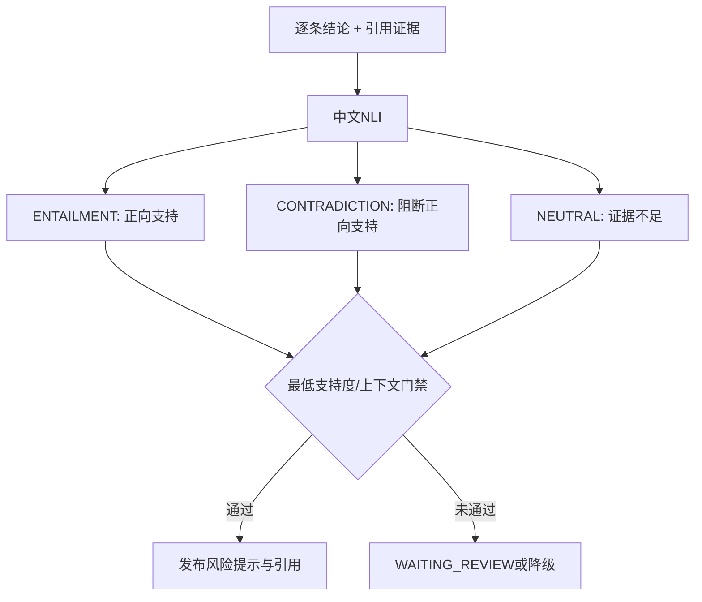

# 05 NLI、人工审核与模型服务

## Q48：Reranker 和 NLI 有什么区别？

**参考回答：** Reranker 判断片段与查询的相关性；NLI 判断给定证据 `premise` 是否支持、反驳或无法确定一条结论 `hypothesis`。相关不等于支持。Java 端校验返回 `model_type=nli`，不能把 Reranker 分数冒充法律结论支持度。

## Q49：一条回答如何拆成可评估的结论？

**参考回答：** `LegalConclusionSupportEvaluator` 按句号、问号、分号、换行及编号边界拆分，过滤极短片段，再逐条和引用证据比较。规则拆句无法保证法律语义边界完美，复杂长句或否定句需要专项样本验证。

## Q50：NLI 的三个标签怎样影响发布？

**参考回答：** `ENTAILMENT` 可形成正向支持，`CONTRADICTION` 阻断把该证据算作支持，`NEUTRAL` 只给有限支持或提示证据不足。整体还看最低支持度、上下文状态和审核条件，不能单凭一个高分就发布完整法律结论。

## Q51：模型不可用时能说答案经过语义验证吗？

**参考回答：** 不能。Java 侧回退词面重合基线，并把 `supportMethod` 标为 `LEXICAL_BASELINE`；该分数只反映字符重合，不能代表法律蕴含。低支持度仍受人工审核门禁约束。

## Q52：为什么不用 RAG 相关度直接当作结论支持度？

**参考回答：** 相关法规可能描述同一主题却包含相反条件。例如某段涉及维修责任，结论却把出租人和承租人对调；它会很相关但不支持结论。先召回，再验证“证据→结论”的关系，是两个不同问题。

## Q53：人工审核节点什么时候触发？

**参考回答：** 逐条结论支持度不足时任务进入 `WAITING_REVIEW`，生成待审核记录和通知；审核通过后才发布结果，拒绝则反馈失败或需补证。审核队列和租约已有实现，但生产运营仍需审核时限、升级机制、律师标注与审计报表。

## Q54：模型分数阈值怎么定？

**参考回答：** 不能仅凭几个例子拍脑袋。应收集律师标注的支持、冲突、证据不足样本，按风险类别和误判成本画混淆矩阵、PR 曲线，再定支持、部分支持与审核阈值。高风险结论可使用更严格门槛。

## Q55：25% 字符基线准确率说明什么？

**参考回答：** 它来自早期 8 条合成样本的字符级对照，说明词面重合不适合承担法律语义判断。不是当前真实 NLI 模型准确率，更不能当生产语义质量指标。

## Q56：模型超时、429 或 503 时怎样处理？

**参考回答：** Java 端有按依赖隔离的超时、重试和熔断；NLI 端有有界队列，过载返回 429，未就绪返回 503。任务可走明确标记的降级路径，不能把失败当作 NLI 已验证。重试要有预算，避免容量不足时放大拥塞。

## Q57：动态微批与 INT8 分别优化什么？

**参考回答：** 微批在短窗口内合并请求，减少模型调用开销；CPU INT8 减少计算和内存压力；队列容量限制排队延迟。要同时监控 P95、吞吐、429 和质量变化，因为批等待会影响低负载延迟，量化也可能改变预测。

## Q58：为什么用 HAProxy 主动健康检查？

**参考回答：** 早期 Nginx 被动摘除在故障窗口暴露较多 429。HAProxy 按 `/ready` 主动判断模型是否加载完成，用 `leastconn`、`fall/rise` 与重派发切换副本。一个副本关闭后的 32 VU、320 请求测试全部成功；这是特定局部故障场景。

## Q59：真实中文 NLI 接入后就能上线法律结论吗？

**参考回答：** 不能。通用中文 NLI 对法律语义、否定条件和地域法规可能失准。接入证明工程链路能运行；上线还需要律师标注集、模型版本锁定、法规更新机制、分层评估、阈值校准和人工审核闭环。
