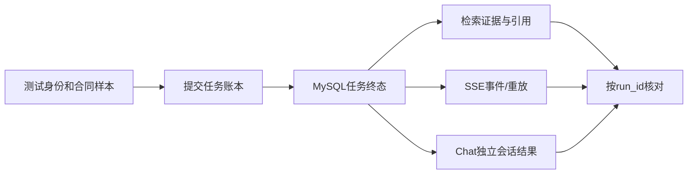

# 06 指标、压测与面试追问

## Q60：P95、P99、吞吐与成功率分别说明什么？

**参考回答：** P95/P99 是延迟分布的百分位，吞吐是单位时间完成的业务请求数，成功率要按业务条件判断。P95 不是最大值，高吞吐也可能伴随大量 429。每个指标都要带入口、负载、样本和环境。

## Q61：RAG Recall@4 98.53% 是否说明 98.53% 的风险都能查出来？

**参考回答：** 不是。它仅说明 34 条冻结检索样本中的相关法规证据在前四条结果的召回比例。合同解析、事实理解、法规解释和最终风险判定还需要独立评估。

## Q62：citation validity 100% 是否说明没有幻觉？

**参考回答：** 不是。37 条回答样本中引用索引都指向允许证据；coverage 是 93.24%，说明仍有事实引用覆盖不足。即使引用存在也可能错解条款，所以要看逐条支持度与人工评估。

## Q63：1000 SSE 连接 P95 22.75ms 是 1000 并发 Agent 吗？

**参考回答：** 不是，这是 Gateway+Legal 的 SSE 建连与心跳场景。连接数与推理并发不是一回事；模型推理、任务入队和端到端答案需分别压测。

## Q64：双副本 NLI 32.18 req/s 是否是 Agent 容量？

**参考回答：** 不是。64 VU、640 请求直接压 `/entailment`，629 成功、11 拒绝，P95 2.67s。Agent 端到端还包含 Tika、Chat/House、MySQL、RAG、生成与 SSE，不能把模型子链路吞吐当整体容量。

## Q65：故障接管 100% 成功代表生产高可用吗？

**参考回答：** 只说明停一个 NLI 副本后，该次 32 VU、320 请求在另一副本上全部成功，P95 1.62s。网络分区、双副本故障、长时间过载和跨机房问题仍未覆盖。

## Q66：如何压测完整 Agent？

**参考回答：** 分层测解析吞吐、检索 Recall/P95、模型吞吐和 429、任务入队/租约恢复、SSE 建连/重放；再用真实租客 Token、不同长度合同、聊天和法规数据测端到端 P95/P99。使用同一 run_id 对账请求、任务、事件、最终回答和引用，避免只看 HTTP 200。

## Q67：离线 RAG 指标高，为什么真实任务会返回 `NO_EVIDENCE`？

**参考回答：** 冻结集和真实任务的数据分布、地区、法规版本及证据阈值不同。报告中的一个真实任务因开发法规库没有足够片段返回 `NO_EVIDENCE`；它能证明任务与通知链路运行，不证明法律问答质量已经生产验收。

## Q68：如果压测时有 429，该说成功还是失败？

**参考回答：** 要分层报告：过载保护是否按设计拒绝、业务成功数与拒绝数、拒绝后重试/降级的结果。比如 NLI 双副本 640 次中有 11 次拒绝，不能只报 32.18 req/s。容量线应结合可接受的成功率与尾延迟定义。

## Q69：怎么证明数据不会跨租客泄漏？

**参考回答：** 会话创建、合同绑定、任务查询、事件重放、SSE 订阅和审核操作都校验租客与资源归属；查询条件带 tenantId 和 taskId。还要设计负例测试：租客 B 用租客 A 的合同 ID、任务 ID、事件 ID 访问，必须失败。只在前端隐藏入口不构成隔离。

## Q70：OpenTelemetry 是否已经有完整分布式追踪平台？

**参考回答：** 代码通过 OpenTelemetry API 在阶段上建立 span，同时保存业务 trace 事件；但 Collector、导出器、Trace UI 和采样策略仍需单独部署。面试时说“接入 OTel API 埋点”，不要声称已经具备完整生产 Trace 平台。

## Q71：如果要上线，下一步优先改什么？

**参考回答：** 第一优先是质量门禁：律师标注的合同、法规冲突和噪点样本，验证误判、漏判与引用支持度。第二是任务终态到事件/Chat 投递的失败补偿与审计。第三是在独立资源下做端到端阶梯压测、长稳态和多故障演练。

## Q72：独立开发项目如何证明你的贡献？

**参考回答：** 当场展示一条可复现链路，以及对应的任务表、检索器、SSE 控制器、NLI 服务、测试脚本和报告。说明哪些是代码功能、哪些经过单测/本地 Docker 验证，哪些尚未做生产验收。能指出一个真实边界，比只罗列组件可信。

## Q73：如果面试官说“这就是堆技术”，怎么回答？

**参考回答：** 按问题讲取舍：Tika 为统一解析；混合 RAG 处理精确条文与语义改写；任务与租约处理长耗时和重启；SSE 提供状态反馈；NLI 与审核控制证据风险。若业务量很小，先用单库与简化任务实现，再以故障和容量数据决定是否启用 Milvus、多副本和更复杂的事件链路。

## 面试前优先复习的十组

1. Q01–Q03：一分钟讲清 Agent 边界与真实链路。
2. Q09–Q12：Tika、DOCX 页码、扫描件与切块。
3. Q14–Q19：三路检索、RRF、Milvus、引用白名单。
4. Q21–Q22、Q61–Q62：RAG 和 citation 指标口径。
5. Q23–Q31：压缩与 `STALE_CONTEXT` 的条件。
6. Q33–Q39：事务边界、租约、Checkpoint 与 replay 限制。
7. Q40–Q46：RabbitMQ、Redis Stream、SSE 与重放。
8. Q48–Q55：Reranker 和 NLI 的区别、人工审核。
9. Q56–Q65：过载、微批、INT8 与故障指标。
10. Q66–Q73：端到端压测、安全、生产差距与架构取舍。

## 简历措辞核对备忘（本次未修改 HTML）

- “阶段级 replay”应说明当前仅 `CONTEXT_AND_EVIDENCE` 可重放。
- “Tika 保留页码”应区分 PDF 和 DOCX 的定位可靠性。
- “双副本吞吐 32.18 req/s”同时交代 629 成功、11 拒绝。
- “故障接管成功率 100%”限定为单副本停止后的 320 请求。
- “OpenTelemetry 链路”只说 API 埋点，完整 Collector/UI 尚未验证。
