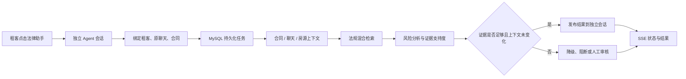
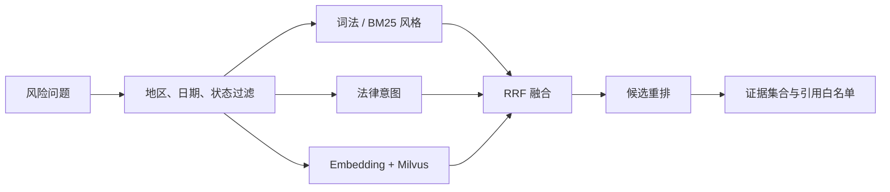
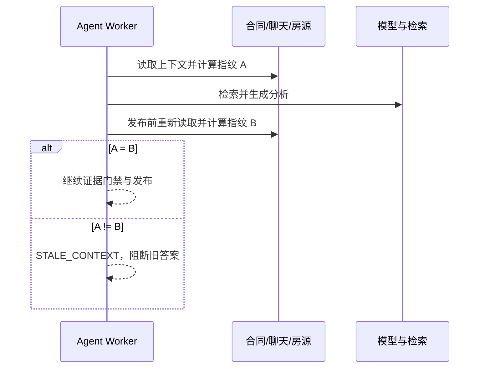
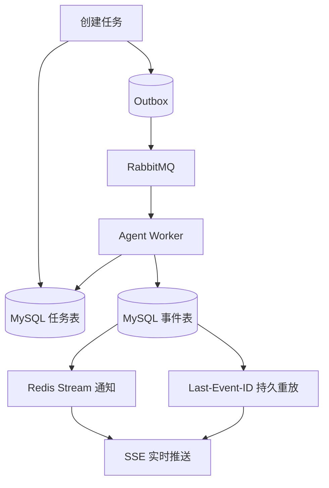

# 法律 Agent 面试问答

依据最终简历的四条 Agent 经历、`deploy/data/legal-module-analysis.md` 与当前代码整理。答案按面试口述写法组织；数字仅代表对应测试条件。建议先掌握 1～12，再练故障和指标追问。

## 一、业务流程与整体架构

### 1. 请用一分钟介绍这个 Agent

租客在与房东聊天到签约阶段时，点击法律助手会创建独立会话。Agent 关联原聊天和合同，读取合同条款、聊天承诺、房源信息与有效法规，给出租赁风险提示及可追溯引用。耗时分析通过异步任务执行，前端通过 SSE 收取状态和结果。对于证据不足或冲突的结论，系统会降级或进入人工审核。

### 2. 为什么称为 Agent，而不是普通 RAG 问答？

它除了检索和生成，还会按阶段获取合同、聊天和房源工具结果，保存任务状态与 checkpoint，评估每条结论的证据支持度，并根据上下文变化、模型故障和审核状态决定发布、重试或阻断。编排主要由 Java/Spring 实现，并未依赖 LangChain 或 Spring AI。这里的 Agent 是面向固定法律风险场景的工作流，不是无限自主规划的通用智能体。

### 3. 为什么创建独立会话？

原聊天是租客与房东的业务对话，也是证据源。法律助手的分析与追问应由租客私有地查看和留存，因此新建独立会话，并校验租客、`landlordConversationId` 和 `contractId` 的绑定。这样回答不会混入双方聊天，后续还能追溯对应合同与原始消息。

### 4. 合同、聊天、房源、法规分别解决什么问题？

合同提供约定条款，聊天提供承诺或协商事实，房源信息提供商品发布时的客观描述，法规提供规范依据。例如房东聊天承诺免除某费用、合同却要求租客支付，需要先发现事实冲突，再检索适用法规。四类证据保留各自来源 ID，避免把一段聊天当作法规。

### 5. 用户更换合同或聊天新增承诺后怎么办？

重新读取关联上下文并计算 SHA-256 指纹。分析开始和发布前复核指纹；若相关内容变化，标记 `STALE_CONTEXT`，阻断旧答案，基于新版本重做分析。指纹检测的是输入版本变化，并不证明答案正确。

## 二、文档解析与混合 RAG

### 6. Apache Tika 具体负责什么？

上传 PDF/DOCX 后，`TikaLegalDocumentExtractor` 使用 `AutoDetectParser` 提取统一文本和元数据。后续解析器负责切分条款、块序号及定位信息，再入库存证和分析。Tika 是文本提取入口，风险规则与证据检索在后续服务中完成。

### 7. 简历说保留页码、标题，DOCX 页码准确吗？

不应承诺 DOCX 页码与用户最终渲染完全一致。PDF 有相对稳定的页定位；DOCX 页码会受字体、页边距和渲染器影响。回答时强调块序号、段落与标题是主要可追溯定位，DOCX 页码属于辅助定位，必要时回到原文件核验。

### 8. 为什么按合同风险条款切块，不能固定字数截断？

固定截断可能把“谁承担责任”“什么条件下支付”等限定拆开，导致检索到残缺证据。按条款和段落切块可保留语义边界；过长条款仍可限制长度，但要保留标题、块序号与原文映射。

### 9. 法规入库怎么处理版本与失效？

法规来源保留地区、状态、生效时间、失效时间和版本等元数据。检索先按分析日期与地区过滤，再在重叠有效版本中优先选较新版本。仍需在真实法规更新与冲突样本上持续验证，不应把“有过滤逻辑”理解成法规库永远及时准确。

### 10. 混合检索的完整流程是什么？

先筛选有效法规，再做词法/BM25 风格召回、法律意图召回和可选向量召回；使用 RRF 融合名次，对有限候选进行重排，最后把法规片段与合同、聊天、房源证据组装为回答上下文。

### 11. 为什么不用纯向量检索？

租赁条款中的金额、日期、主体、条文编号和否定词需要精确匹配。向量相似度有助于同义表达，但可能把语义相近、适用条件不同的条文召回。词法、意图与向量互补；向量服务失败时也能保留前两路检索。

### 12. BM25 和 TF-IDF 的区别？项目用了现成搜索引擎吗？

BM25 是考虑词频饱和、逆文档频率和文档长度归一化的词法排序方法，比简单词频更适合长短不一的片段。当前项目的词法通道由 Java 检索/排序逻辑实现，面试时可以说“BM25 风格词法召回”，不要擅自说接入了 Elasticsearch。需要具体解释时看 `HybridLegalRanker` 的实际打分实现。

### 13. RRF 为什么适合融合这些通道？

BM25、意图和向量分数不在同一尺度，直接相加难以稳定调权。RRF 按各路名次贡献 `1/(k+rank)` 一类分数，再汇总同一候选，可降低原始分数尺度差异。它不能代替业务过滤与最终证据校验。

### 14. Milvus 存什么？MySQL 又存什么？

Milvus 提供法规片段向量的相似召回；MySQL 保存法规来源、文本、版本、状态与审计信息。向量命中要映射回可核验片段。Milvus 不可用时，可退回受限的本地余弦或词法/意图路径，具体取决于向量数据与开关状态。

### 15. Embedding 与 Reranker 各做什么？

Embedding 把查询和法规片段转成向量，用于快速召回；Reranker 对查询与少量候选逐对评分，重新排序。召回追求覆盖，重排追求前几条更相关。两者的相关性分数都不能证明法规支持某条法律结论。

### 16. Citation allow-list 如何防止编造引用？

只把当前检索、授权且保留来源标识的证据加入允许集合。生成结果中引用的索引必须能映射到集合内的证据；无法映射的引用不予发布。它能约束“引用是否存在”，还要另行评估“引用是否真的支持结论”。

### 17. Recall@4 98.53%、HitRate@4 100% 如何解释？

冻结检索集有 34 条样本。Recall@4 是标注相关证据在前四条结果中的召回比例；HitRate@4 是问题前四条至少命中一项相关证据的比例。这是本地离线集的检索指标，不是现实法律咨询的总体准确率，也不是端到端 Agent 成功率。

### 18. Citation validity 100%、coverage 93.24% 有什么区别？

37 条回答样本中，validity 衡量生成引用是否能指向允许证据，coverage 衡量应引用的事实有多少实际获得引用。100% validity 仍可能遗漏引用；即使引用存在，也可能误读法条条件。因此还需做结论支持度和法律专家复核。

## 三、上下文与记忆

### 19. 为什么要压缩上下文？怎么避免丢失关键条件？

合同和长聊天直接全量送入会增加延迟及截断风险。合同优先保留押金、维修、违约、解约、转租、退租等风险条款；聊天保留金额、时间、责任主体与承诺，并存原消息 ID。压缩摘要用于模型输入，原文和定位信息仍供审计核验。

### 20. 短期记忆、长期记忆、上下文快照是什么关系？

Redis 缓存有界的近期 Agent 对话窗口；MySQL `MemorySnapshot` 保存可恢复的会话摘要；每次评估的上下文快照记录合同、聊天、房源、检索结果的版本与哈希。前两者帮助连续追问，后者帮助回答“这次结论依据的是哪一版资料”。

### 21. Redis 丢失时会怎样？

近期窗口可以尝试从 MySQL 摘要恢复，原始合同和聊天事实仍从各自持久化来源读取。恢复的是有限历史与摘要，不等同于精确恢复全部 Redis 缓存对话，因此需要按当前资料重新核验答案。

### 22. SHA-256 为什么还要在生成后检查一次？

生成过程可能跨越数秒到数十秒，期间合同、聊天或房源信息可能被修改。开始时记录输入指纹，发布前再次读取并比较；变化则不发布旧结论。要说明哈希的输入集合和版本边界，不把“哈希一致”误说成“事实或法律解释正确”。

## 四、任务、故障恢复与 SSE

### 23. 为什么做异步任务？

文档解析、检索和模型推理的耗时波动较大，长时间占用 HTTP 请求线程会降低受理能力。接口先持久化任务并返回任务 ID，由 Worker 执行；用户通过 SSE 看进度和结果。任务状态在 MySQL，使进程重启后仍可恢复。

### 24. 多实例如何防止同一任务被同时执行？

MySQL 中保存任务状态、租约持有者和到期时间，Worker 通过带条件的原子更新领取 `PENDING` 或租约过期的 `RUNNING` 任务。接管可能导致前一实例的外部调用与新实例重叠，因此结果提交、事件与 Chat 投递还要具备状态条件和幂等约束。

### 25. 租约过期接管会不会重复调用模型？

有可能，尤其是旧 Worker 卡住但并未真正退出时。目标不是承诺推理只运行一次，而是保证同一任务的最终状态和对外副作用可控。通过任务条件更新、阶段 checkpoint、Outbox 唯一键与 Chat 幂等键限制重复发布；仍需合理设置租期、心跳和超时。

### 26. Checkpoint 和 replay 的边界是什么？

Checkpoint 记录某阶段状态、输入指纹、输出和尝试次数。失败任务可以 replay；阶段重放会重置指定阶段，再按依赖关系执行。恢复前必须核对输入指纹，不能复用基于旧合同生成的阶段输出。当前实现有阶段状态和重放接口，但不能把它描述成任意节点、任意副作用都可无损恢复的通用工作流引擎。

### 27. Outbox、RabbitMQ、Redis Stream 为什么同时存在？

MySQL 任务及事件表是持久事实；Outbox 将状态变化记录为待投递事件并支持重试；RabbitMQ 承担任务/事件异步传递；Redis Stream 支持跨实例通知和 SSE 事件读取。消费者可能收到重复事件，因此终态更新和消息发布都需幂等。

### 28. 为什么 SSE 用 `SseEmitter`，而不是 WebSocket？

分析进度和结果主要是服务端单向推送，用户发起任务和追问仍可通过 HTTP。SSE 与 HTTP 网关集成直接，事件 ID 支持断线后继续读取。`SseEmitter` 是 Spring MVC 实现 SSE 的 API；它确实是 SSE。

### 29. `Last-Event-ID` 怎么保证断线重放？

事件先持久化并赋递增 ID。客户端重连带上最后处理的 ID，服务端读取该任务之后的事件再订阅实时通知。重放和实时切换可能重叠，因此客户端按事件 ID 去重；Redis Stream 是通知通道，持久事件表是回放依据。

### 30. 1000 个 SSE 连接的 P95 22.75ms 测的是什么？

这是经 Gateway 鉴权、路由、Legal SSE Writer 和心跳路径建立连接的延迟，P99 为 43.30ms。它证明指定本地环境下的建连能力，不能解释为 1000 个 Agent 同时完成推理，也不是完整问答的 P95。

### 31. 慢客户端怎么保护服务？

共享调度器负责心跳和事件检查，独立 Writer 池处理写出；连接数、Writer 队列和每连接积压都应有上限。发送慢或超限时释放连接资源，客户端重连后从持久事件 ID 补读。否则慢连接可能占住 Agent Worker 或不断扩大内存占用。

### 32. RabbitMQ/Redis 短暂不可用会怎样？

任务和事件事实仍在 MySQL；Outbox 可在依赖恢复后重试，任务恢复扫描可重新派发可领取任务。Redis 通知故障会影响实时性，SSE 重连可以从持久事件表恢复。恢复时间和吞吐需要在对应故障压测中单独测量，不能笼统承诺零延迟。

## 五、NLI、审核与模型性能

### 33. Reranker 与 NLI 有什么本质区别？

Reranker 判断片段与问题是否相关；NLI 给定“证据 premise + 结论 hypothesis”，判断支持、反驳或中立。相关片段可能不支持具体结论。Java 侧要求返回 `model_type=nli`，不能把 Reranker 相关性分数标成法律支持度。

### 34. 逐条证据支持度怎么做？

先把回答拆成可评估结论，再逐条与引用证据比较。中文 NLI 输出 `ENTAILMENT/CONTRADICTION/NEUTRAL` 及分数；冲突证据阻断正向支持。模型不可用时标记 `LEXICAL_BASELINE` 并用可审计的词面重合回退，该基线不是法律语义质量证明。

### 35. 为什么要人工审核节点？

证据不足、模型冲突或低支持度结论不能直接作为可信法律意见发布。任务进入 `WAITING_REVIEW`，审核通过后才发布，拒绝则给出失败/需补证状态。当前已实现审核状态与租约，真实上线仍需更大规模律师标注、阈值校准和审核运营流程。

### 36. 模型超时或返回 429 怎么办？

Java 调用侧按依赖配置超时、重试与熔断，服务端有界队列过载返回 429；Agent 主链路可降级到词面基线或规则分析，同时显式记录支持度方法。不能把降级结果伪装为 NLI 已验证的结论，低支持度继续受人工审核门禁约束。

### 37. 动态微批与 CPU INT8 各解决什么问题？

动态微批把短等待窗口中的请求合并推理，摊薄调度开销；INT8 降低 CPU 权重计算和内存开销。有界队列限制等待长度。低负载时微批等待可能增加单请求延迟，量化也需核查模型质量，因此同时观测吞吐、P95、429 比例和语义指标。

### 38. 双副本 + HAProxy 的故障接管如何验证？

两个 NLI 副本通过 `/ready` 表明模型真正加载完成，HAProxy 主动探测并摘除失效副本。单副本停止后的指定场景为 32 VU、320 请求，全部成功，P95 1.62s；该结果是模型服务的局部故障测试，不能推广为整个 Agent 的生产高可用承诺。

### 39. 双副本 32.18 req/s、P95 2.67s 是 Agent 端到端性能吗？

不是。这是双副本 NLI `/entailment` 接口在 64 VU、640 请求下的本地压测，629 成功、11 个过载拒绝。完整 Agent 还包括解析、数据库、RAG、生成、证据门禁和 SSE，必须另测端到端延迟和成功率。面试时应主动说出 11 个拒绝，避免只报吞吐。

### 40. 真实中文 NLI 模型能直接用于生产法律判断吗？

不能直接这样宣称。项目已接通真实中文 NLI 推理及故障切换，但通用 NLI 与法律语义仍有领域差距。当前小规模合成/冻结集适合验证工程链路；生产质量需要律师标注集、法规版本化、冲突样本、分层混淆矩阵与阈值校准。

## 六、压测设计、局限与架构追问

### 41. 你会怎样设计完整 Agent 压测？

分开测合同解析吞吐与 P95、法规检索 P95/Recall、NLI 推理吞吐与拒绝率、SSE 建连/重放、任务入队与恢复，再测真实租户的端到端问答 P95/P99。记录硬件、容器数、数据集、缓存状态和成功判定；负载既包括普通合同，也包括长合同、噪点条款、低证据与上下文变化。

### 42. 为什么离线 RAG 指标高，真实任务仍可能返回 `NO_EVIDENCE`？

离线集验证的是已标注问题和特定法规数据；真实任务还依赖当前法规库的有效版本、地区匹配、合同质量和证据阈值。报告中的一次真实开发任务因法规片段不足返回 `NO_EVIDENCE`，证明任务/SSE/幂等链路能运行，不证明回答质量已达生产标准。

### 43. 如何防止租客 A 读到租客 B 的合同或聊天？

在创建独立会话、绑定合同、读取任务、订阅 SSE、重放事件与审核接口分别校验租户身份及资源归属。缓存 key、任务查询和事件查询也要带租户/会话作用域。不能只信前端传入的 `contractId` 或 `conversationId`。

### 44. 如果让你再优化，优先做什么？

先补真实合同和律师标注的冻结评估集，按押金、维修、正常折旧、违约等类别量化误判与漏判；随后测完整 Agent 的 P95/P99 和失败恢复。工程上进一步完善法规更新监控、审核队列时限和 OpenTelemetry Collector/Trace UI，把“有埋点”变成可用的跨服务诊断。

### 45. 你独立开发，如何说明项目的真实性和你的贡献？

展示一条可复现链路：创建独立会话、上传测试合同、运行分析、查看引用和 SSE 事件，再指出任务表、checkpoint、Outbox、Redis Stream、NLI 服务及压测脚本的位置。明确区分代码功能、单元/集成测试、Docker 本地压测与尚未完成的生产验收。

## 七、数字速查与面试禁区

| 简历数字 | 正确口径 | 不应表述为 |
| --- | --- | --- |
| Recall@4 98.53%，HitRate@4 100% | 34 条冻结检索样本的前四条召回 | 法律结论准确率 98.53% |
| Citation validity 100%，coverage 93.24% | 37 条回答样本的引用有效性与覆盖率 | 无幻觉、无遗漏 |
| 1000 SSE，P95 22.75ms | Gateway + Legal 的 SSE 建连 | 1000 个 Agent 并发推理 |
| NLI 双副本 32.18 req/s，P95 2.67s | 64 VU、640 请求的模型服务子链路，629 成功 | 完整 Agent 端到端吞吐 |
| 故障接管 100%，P95 1.62s | 停止一个 NLI 副本后 32 VU、320 请求 | 所有故障场景的生产 SLA |
| 字符基线 25% | 8 条合成样本的早期词面评估 | 真实中文 NLI 的生产准确率 |

面试最稳妥的说法是：先报**测试对象、环境、样本量或并发条件**，再报结果，最后说清尚未验证的范围。

## 代码与报告入口

- 根目录 `README.md`：整体项目与模块简介。
- `deploy/data/legal-module-analysis.md`：各阶段实现、压测和限制。
- `deploy/data/legal-resume.md`：四条 STAR 项目经历。
- `anyujia-legal/anyujia-legal-service/src/main/java/.../service/`：解析、检索、记忆、任务、checkpoint 和支持度实现。
- `deploy/embedding/app.py`：本地 Embedding/Reranker/NLI 服务。
- `deploy/eval/legal-rag/`、`deploy/eval/legal-entailment/`：离线评估集与脚本。
